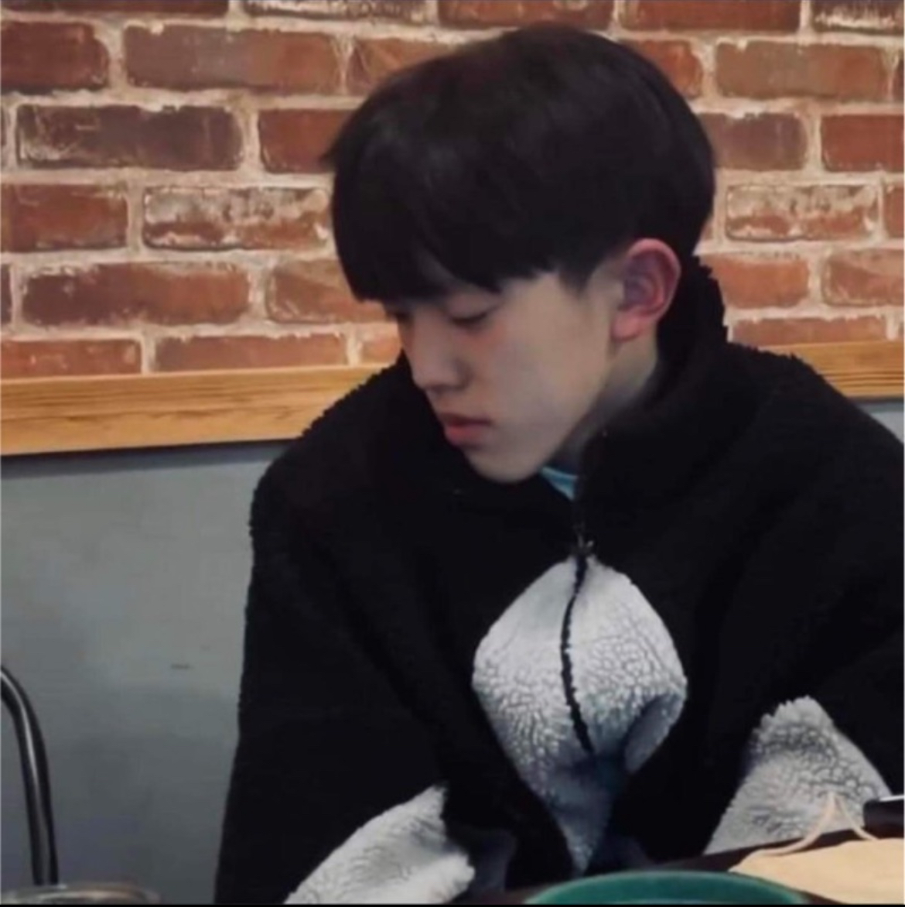
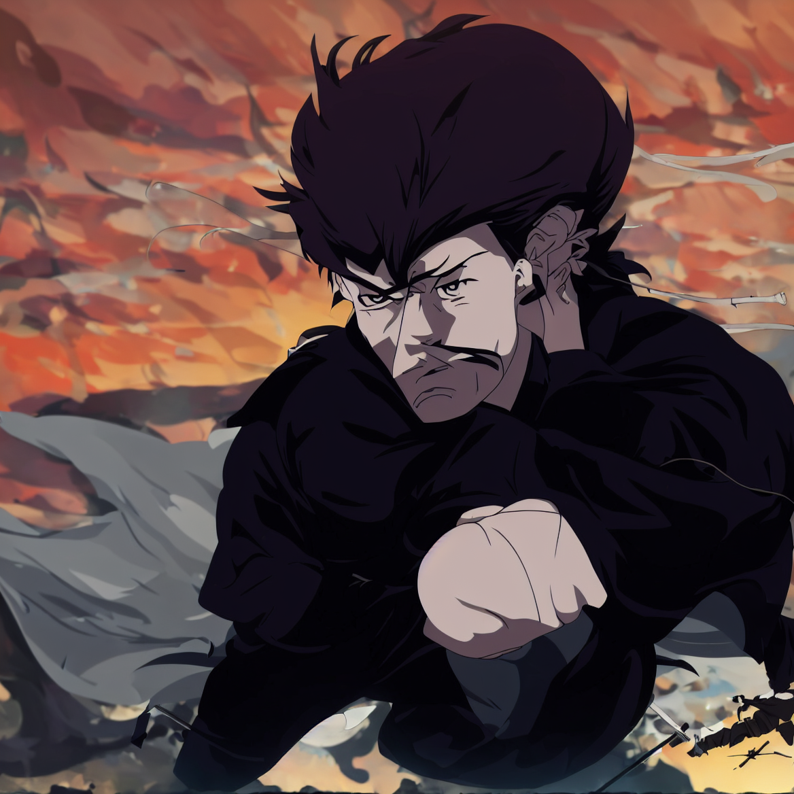
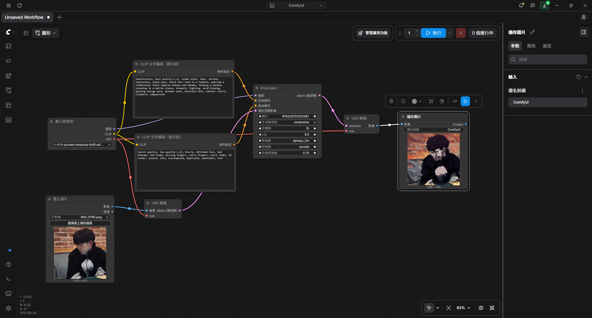

## 原圖

## 生成圖

## 完整工作流截圖

### 正提示詞

#### (masterpiece, best quality:1.2), anime style, 1man, serious expression, sharp eyes, black hair tied in a topknot, wearing a traditional black samurai kimono and hakama, holding a katana, standing in a battle stance, dramatic lighting, wind blowing, glowing energy aura, dynamic pose, detailed face, vibrant colors, cinematic composition

### 反提示詞

#### (worst quality, low quality:1.4), blurry, deformed face, bad anatomy, bad hands, missing fingers, extra fingers, extra limbs, 3d render, plastic skin, overexposed, duplicate, watermark, text

## 心得

#### 其實我還是不太會用這個程式，我邊琢磨這個照片與去雜訊度的關係，有慢慢了解大致上的運作流程，我想改成原子武士，但是他改的好抽象。
